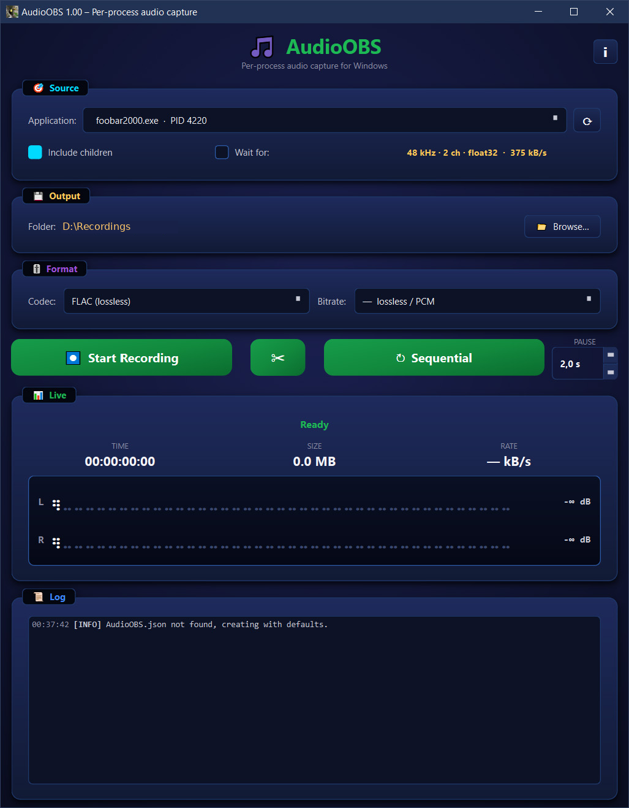

# AudioOBS

**A quiet observation lounge for your apps' audio.**

Per-process audio capture for Windows. Picks one running application and
records *only* its audio — no system mix, no microphone bleed, no other
apps. Output goes through `ffmpeg`, so you can save as FLAC, ALAC, MP3,
AAC, Opus, EAC3 or WAV (float32 PCM).



---

## Features

- **Per-process capture** — pick any running app from the dropdown.
  An app only appears once it is actually playing audio; when the list
  is empty AudioOBS says so and points the way
- **"Wait for:" with history** — arm AudioOBS against an app that
  isn't running yet by `.exe` name. The Wait-for field is an editable
  combo box that remembers the apps you've waited for before, so you
  can re-pick them from the drop-down instead of retyping
- **Include child processes** — captures spawned helpers too (Chrome
  audio service, Spotify renderer, etc.)
- **Sequential / album mode** — arms and waits for the first audible
  sample, then auto-splits into individual track files whenever the
  level stays below about -50 dB for the configured pause. The PAUSE
  spinbox next to the button (0.5–30 s, default 2 s) can be changed
  while recording
- **Manual track-split** — scissors button closes the current file and
  starts a new one instantly, even when songs blend without a gap
- **Live VU meter** — Braille-glyph bars on a 0 dBFS-anchored scale.
  The bar shows RMS (green, yellow above -10 dB); the floor goes from
  -40 dB in a narrow window down to -90 dB in a wide one. A per-channel
  peak-hold marker follows the true sample peak and turns orange near
  0 dBFS (from -3 dB) and red at 0 dBFS
- **Scrolling Spectrogram** — click the meter to toggle. Log-frequency
  waterfall display (20 Hz – 20 kHz), magma colour map, L/R panels.
  Pure NumPy / FFT under the hood
- **WASAPI format readout** — sample rate, channel count, sample depth
  and raw data rate of the currently captured source, shown live
- **Startup ffmpeg check** — on launch AudioOBS looks for ffmpeg on
  `PATH` and in a few common install folders. If it isn't found, it
  explains what still works without it (live monitoring) and how to
  install it
- **Full save-state** — output folder, codec and bitrate, sequential
  pause-gap, last source, Wait-for state and history, meter view and
  window geometry are all stored in `AudioOBS.json` next to the EXE
  (or next to the script when run from source). A missing folder or
  stale value falls back to a safe default rather than blocking
  startup

---

## Requirements

| | |
|---|---|
| OS          | Windows 10 build 19041 (version 2004) or newer — older builds lack the Process Loopback API |
| Python      | 3.10+ (for running from source) |
| Audio enc.  | `ffmpeg.exe` (any recent build) — on `PATH` or in one of the folders listed under [ffmpeg setup](#ffmpeg-setup) |
| Python deps | `PySide6`, `numpy` (only for running from source) |

> Without `ffmpeg`, recording is disabled, but live monitoring — source
> picking, VU meter, spectrogram and the WASAPI format readout — still
> works. AudioOBS checks for `ffmpeg` at startup and tells you how to
> install it if it is missing.

---

## Download

The ready-to-run Windows build is the single file
`AudioOBS, v1.00.exe`, packed as a split ZIP archive:

- `AudioOBS, v1.00.zip`
- `AudioOBS, v1.00.z01`

Download **both** parts into the same folder and open the `.zip` with
an archiver that supports split archives (e.g. 7-Zip). `AudioOBS.json`
is created next to the EXE on first launch. ffmpeg is not included —
see below.

## Run from source

```cmd
pip install PySide6 numpy
python AudioOBS_1_00.py
```

These files must sit in the same folder:

- `AudioOBS_1_00.py` — the GUI
- `wincaptureaudio.py` — ctypes bindings
- `wincaptureaudio.dll` — the prebuilt capture core (64-bit; use a
  64-bit Python)

Optional: `resources\icons\` with `AudioOBS.ico`, `logo_styled.png`
and `logo.png` (window/taskbar icon and About-dialog logo). They are
not part of this repository; the app runs fine without them.

## ffmpeg setup

AudioOBS looks for ffmpeg once at startup, in this order:

1. `ffmpeg` / `ffmpeg.exe` on `PATH`
2. `%ProgramFiles%\ffmpeg\bin\ffmpeg.exe`
3. `%ProgramFiles(x86)%\ffmpeg\bin\ffmpeg.exe`
4. `%LOCALAPPDATA%\Programs\ffmpeg\bin\ffmpeg.exe`
5. `C:\ffmpeg\bin\ffmpeg.exe`
6. `C:\tools\ffmpeg\bin\ffmpeg.exe`

Easiest: download a Windows build (e.g. from
[gyan.dev](https://www.gyan.dev/ffmpeg/builds/) or
[BtbN](https://github.com/BtbN/FFmpeg-Builds/releases)), extract it to
`C:\ffmpeg\` so that `C:\ffmpeg\bin\ffmpeg.exe` exists, and
optionally add `C:\ffmpeg\bin` to `PATH`. Restart AudioOBS afterwards.
`ffmpeg -version` in a new Command Prompt should print a version
banner.

---

## Usage notes

- **Output files** go to the folder shown in the Output card
  (default: your Desktop, or your home folder if there is none):
  - single recording: `AudioOBS_YYYYMMDD_HHMMSS_<app>.<ext>`
  - sequential: `AudioOBS_YYYYMMDD_HHMMSS_segNNN_<app>.<ext>`
    (one session timestamp, numbered segments)
- **Wait for:** — once the named `.exe` opens an audio session,
  AudioOBS selects it, unticks the box and starts a normal
  (single-file) recording. On launch, the last used source is
  re-selected if it is playing; if no app is playing at all, it is
  pre-armed in **Wait for:** instead.
- **Split** (scissors) closes the current file and starts a new one.
  In a normal recording the new file gets a fresh timestamp and the
  TIME display restarts.
- **Include children** and the source picker are locked while a
  recording is running.
- Settings are written to `AudioOBS.json` whenever something changes.
  Keys: `save_dir`, `codec_index`, `bitrate_index`, `include_children`,
  `seq_pause_seconds`, `window_size`, `window_pos`, `last_source_exe`,
  `wait_for_enabled`, `wait_for_exe`, `wait_for_history`,
  `meter_view_index`, `settings_version`. Delete the file to reset
  everything to defaults. An unreadable file is logged and replaced
  with defaults.

## Troubleshooting

| Symptom | What to check |
|---|---|
| "DLL not loaded" / everything greyed out | `wincaptureaudio.dll` must sit next to `wincaptureaudio.py`; Python must be 64-bit; Windows 10 2004 or newer. The log shows the exact error. |
| Source list is empty | Only apps with an active audio session are listed — start playback first, or use **Wait for:** with the `.exe` name. |
| "ffmpeg not found" / "ffmpeg missing" | See [ffmpeg setup](#ffmpeg-setup); restart AudioOBS after installing. |
| Settings are not kept | AudioOBS needs write access to the folder that contains the EXE / script (avoid e.g. `C:\Program Files`). The log shows "Could not write AudioOBS.json". |
| Sequential never starts a file | It waits for audio above about -50 dB. Check the VU meter. |
| Sequential splits inside a track | Raise the PAUSE value; quiet passages longer than the pause count as a gap. |

---

## How it works

```
+----------------+    +----------------------+    +------------+
|  Source app    |    |  wincaptureaudio.dll |    |  AudioOBS  |
|  (Spotify,     |--->|  WASAPI Process      |--->|  GUI       |
|  Chrome,       |    |  Loopback + Mixer    |    |  (PySide6) |
|  foobar2000…)  |    |  (C++)               |    |            |
+----------------+    +----------------------+    +------+-----+
                                                         |
                                                         | float32 PCM
                                                         v
                                                  +-------------+
                                                  |  ffmpeg     |
                                                  |  subprocess |--> .flac / .mp3 / .opus / ...
                                                  +-------------+
```

The DLL is adapted from
[bozbez/win-capture-audio](https://github.com/bozbez/win-capture-audio),
which was originally an OBS Studio plugin — that's where the "OBS" in
the name comes from. The current build pulls audio at the WASAPI mix
format (48 kHz / 2 ch / float32) and hands it to a callback. The
Python GUI pipes the PCM straight into a long-lived `ffmpeg`
subprocess via stdin.

A process only shows up in the source picker once it has an active
WASAPI audio session — i.e. once it has actually played a sound. An
app that is open but silent has no session for Windows to enumerate.
That is what **"Wait for:"** is for: it polls until the named `.exe`
opens a session and starts recording the moment it does.

VU meter and silence detection use `np.dot(x, x) / N` for one-pass
RMS. The spectrogram does `np.fft.rfft` on a Hann-windowed 2048-sample
slice each tick, maps log-frequency bins to display rows through a
precomputed index table, and pulls magma colours through a 256-entry
LUT — no Python loop on the hot path.

---

## Repository contents

```
AudioOBS/
├── AudioOBS_1_00.py                 # the GUI (entry point)
├── wincaptureaudio.py               # ctypes bindings for the DLL
├── wincaptureaudio.dll              # prebuilt C++ capture core
├── AudioOBS, v1.00.zip              # Windows build (split ZIP, last part)
├── AudioOBS, v1.00.z01              # Windows build (split ZIP, first part)
├── screenshot.png
├── CHANGELOG.md                     # version history
├── LICENSE                          # GPL-2.0 license text
├── GNU GENERAL PUBLIC LICENSE.txt   # GPL-2.0 license text (copy)
├── _gitignore                       # ignore rules (not active under this name)
└── README.md                        # this file
```

The C++ sources of the DLL and the build scripts for the EXE are not
part of this repository.

---

## License

GPL-2.0-or-later. The C++ capture core is adapted from
[win-capture-audio](https://github.com/bozbez/win-capture-audio) (GPL-2.0),
which forces GPL on the linked product. New files in this repository
are licensed the same way. See [`LICENSE`](LICENSE).

---

## Acknowledgements

- **[bozbez/win-capture-audio](https://github.com/bozbez/win-capture-audio)** —
  the WASAPI Process Loopback C++ code
- **[Microsoft WIL](https://github.com/microsoft/wil)** — modern C++
  helpers for Win32/COM
- **[FFmpeg](https://ffmpeg.org/)** — the entire encoding pipeline
- **[PySide6 / Qt](https://doc.qt.io/qtforpython-6/)** — the GUI
- **[NumPy](https://numpy.org/)** — VU/RMS math and the spectrogram FFT
- **[BTop](https://github.com/aristocratos/btop)** — Braille-glyph VU
  meter inspiration
- **[Audacity](https://www.audacityteam.org/)** — spectrogram display
  conventions
